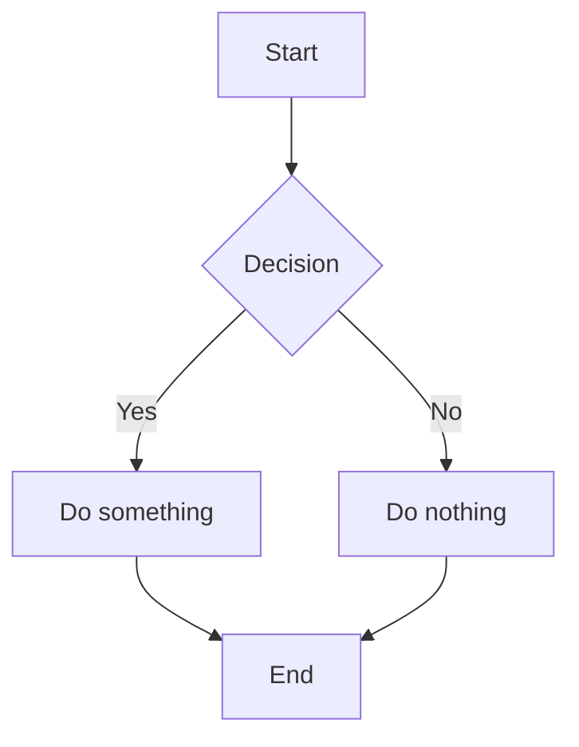
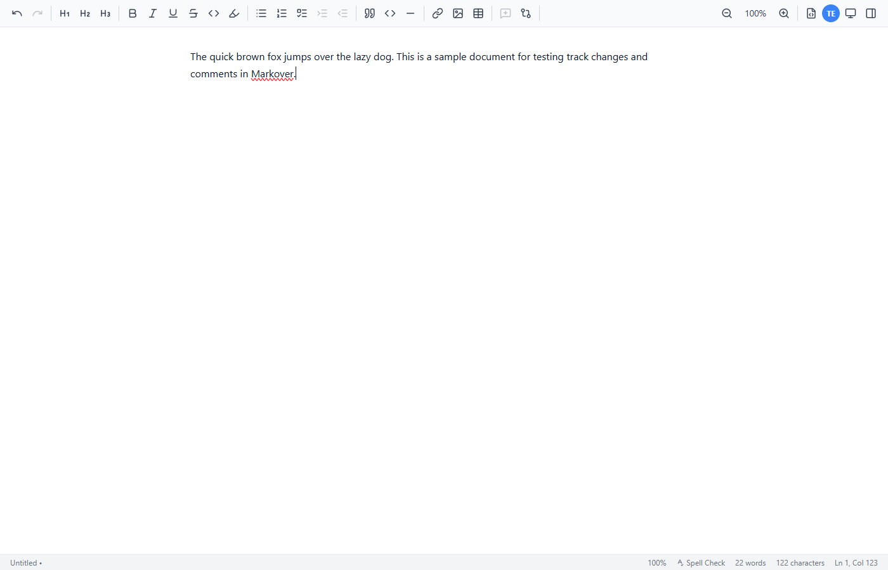

# Markover Test Document

This is a **bold** and _italic_ test with some `inline code` and ~~strikethrough~~.

## Lists

- Bullet item 1

- Bullet item 2

  - Nested item

- Bullet item 3

1. First ordered
2. Second ordered
3. Third ordered

## Task List

- [x] Completed task
- [ ] Incomplete task
- [ ] Another task

## Code Block

```javascript
function hello() {
  console.log("Hello, Markover!");
}
```

## Blockquote

> This is a blockquote.  
> It can span multiple lines.

## Table

| Feature | Status | Notes |
| --- | :---: | ---: |
| Bold | Done | Works well |
| Tables | Done | Basic support |
| Images | Test | URL, local path, drop, and paste |

## Math

Inline math: $E = mc^2$ and $\sum_{i=1}^{n} x_i$.

Block math:

$$
\int_0^\infty e^{-x^2} dx = \frac{\sqrt{\pi}}{2}
$$

## Mermaid Diagram



## Footnotes

This has a footnote[^1] and another one[^2].

## Links and Images

Here is a [link to GitHub](https://github.com) and an image:



## Numeric Display Review

Each case below includes an expected value in code formatting and a live example underneath. Compare the characters, spacing, formatting, table columns, and rows. Code formatting is a reference; the live example should retain the same values while using the surrounding document style.

First inspect this original file. Then use **Save As** to create a separate copy, close it, and reopen the copy. Compare again, especially the cases marked **Reopen check**. Keep this original as the reference because some known bugs only appear after saving.

### N01 - Integers, Decimals, and Separators

Expected: all digits, signs, separators, and trailing zeros remain unchanged.

```text
0; 1; -1; 0.00; 12.50; 1,234.56; -1,234.56; 1.234,56; 1e6
```

Live: 0; 1; -1; 0.00; 12.50; 1,234.56; -1,234.56; 1.234,56; 1e6

### N02 - Percentages

Expected: percent signs, decimal places, and negative signs remain visible.

```text
0%; 0.00%; 10%; 12.5%; -0.25%; 100%; 150%
```

Live: 0%; 0.00%; 10%; 12.5%; -0.25%; 100%; 150%

### N03 - A Single Dollar Amount

Expected: `Total: $1,234.56`. This is a control case with only one dollar sign in the paragraph.

Total: $1,234.56

### N04 - Two Dollar Amounts

Expected: `Prices are $10.00 and $20.00.` Both dollar signs and ordinary word spacing should remain visible. This checks that currency is not mistaken for math.

Prices are $10.00 and $20.00.

### N05 - Money and Tax Percentage

Expected: `A $100 item with 10% tax costs $110.` The complete phrase, including the percent sign and the words after it, should be visible.

A $100 item with 10% tax costs $110.

### N06 - Formatted Prices

Expected: two separate bold amounts, `$10.00` and `$20.00`, joined by ordinary text. The dollar signs must not consume the bold markers or change the text into a formula.

**$10.00** and **$20.00**

Expected: the percentage remains bold and the decimal amount remains italic.

Margin: **12.5%**. Net amount: _1,234.56_.

### N07 - Escaped Dollar Amounts

**Reopen check:** these should initially be ordinary text and stay ordinary text after saving and reopening. Expected: `Prices are $10.00 and $20.00.` Backslashes protect the dollar signs in the Markdown source and should not be displayed.

Prices are \$10.00 and \$20.00.

### N08 - Currency in Code

Expected: the entire calculation is displayed literally in code formatting. This is a control case, not a mathematical formula.

`$100 + 10% = $110`

### N09 - Prices Across Source Lines

Expected: all labels, amounts, and the percent sign remain visible as ordinary text. Markdown may join these soft source line breaks with spaces; that is acceptable. It must not turn the paragraph into a formula.

```text
Price: $100
Tax: 10%
Total: $110
```

Price: $100
Tax: 10%
Total: $110

### N10 - Other Currencies and Currency Codes

Expected: all currency symbols, codes, minus signs, and accounting parentheses remain visible.

```text
EUR 1.234,56; GBP 1,234.56; AUD 1,234.56; €1.234,56; £1,234.56; ¥1,234; -12.50; (12.50)
```

Live: EUR 1.234,56; GBP 1,234.56; AUD 1,234.56; €1.234,56; £1,234.56; ¥1,234; -12.50; (12.50)

### N11 - Numeric Table Alignment

Expected: three data rows. Amount and Rate columns are right-aligned, and every trailing zero is retained. Each cell contains a single amount or percentage.

| Item | Amount | Rate |
| :--- | ---: | ---: |
| Standard | 1,234.50 | 12.50% |
| Credit | -20.00 | -0.25% |
| Zero | 0.00 | 0.00% |

### N12 - Currency Table Cells

**Reopen check:** expected two rows containing dollar amounts in their original columns. The same-cell range also tests whether two escaped prices stay plain text after saving.

| Item | Net | Gross | Range |
| :--- | ---: | ---: | :--- |
| Standard | \$100.00 | \$110.00 | \$10.00 to \$20.00 |
| Zero | \$0.00 | \$0.00 | None |

### N13 - Literal Pipe Beside a Percentage

**Reopen check:** expected exactly two columns. The Condition cell contains `x | y`, and the Value cell contains `12.5%`. Saving must not split the condition into extra columns or discard the percentage.

| Condition | Value |
| :--- | ---: |
| x \| y | 12.5% |

### N14 - Two Amounts in One Table Cell

**Reopen check:** expected one data row with two amounts on separate lines inside the Revenue cell. The Margin cell contains `12.5%` on that same row. Saving must not create a second data row.

| Revenue | Margin |
| ---: | ---: |
| 1,234.56<br>2,345.67 | 12.5% |

### N15 - Numeric Text at the Start of a Paragraph

**Reopen check:** the next two examples should remain ordinary paragraphs, not numbered lists. Expected: `2026. Annual revenue: 12.5%` and `2026) Annual revenue: 12.5%`.

2026\. Annual revenue: 12.5%

2026\) Annual revenue: 12.5%

### N16 - Genuine Math Must Still Render

Expected: the expressions below render as formulas. The percentage formula uses an escaped percent sign because it is mathematical notation rather than ordinary prose.

Square: $x^2$.

Percentage formula: $r = 12.5\%$.

Block formula:

$$
100 \times (1 + 0.10) = 110
$$

### N17 - Type Prices in WYSIWYG, Then Reopen

**Reopen check:** replace the placeholder below by typing the following sentence directly into the WYSIWYG editor. Inspect it before saving, then save and reopen the copy. It should remain ordinary text in both views.

```text
Prices are $10.00 and $20.00.
```

Replace this paragraph with the sentence above.

---

That's all for now!

---

[^1]: This is the first footnote.
[^2]: This is the second footnote.

